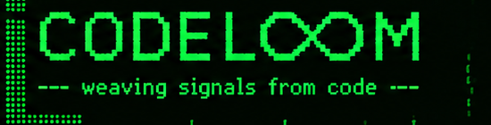
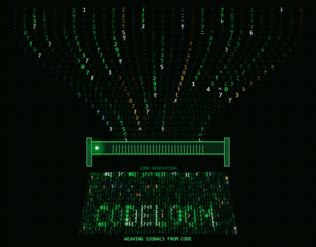

<p align="center">
  
</p>

<p align="center">
  
</p>

<p align="center">
  <a href="docs/assets/codeloom-self-weaving.html">Standalone Canvas animation</a>
  <br><sub>Download and open locally in a browser; GitHub displays HTML source instead of running it.</sub>
</p>

# CodeLoom

CodeLoom is a **Rust coding agent** with a **ratatui** terminal interface. It
coordinates agents, subagents, and jobs, and can run on its own or integrate
with [herdr](https://herdr.dev) as an optional plugin.

CodeLoom uses the **[A2A protocol](https://a2a-protocol.org/latest/definitions/)**
as the foundation for agent communication instead of inventing a
project-specific protocol. Project-specific decisions are documented as such.

## What it does

CodeLoom is implemented and in daily use. It provides:

- An agent loop with OpenAI-compatible providers (such as OpenRouter),
  parallel read tools, exclusive write tools, and permission dialogs.
- Subagents run as **A2A** tasks and support all eight protocol states
  (`submitted`, `working`, `input-required`, `auth-required`, `completed`,
  `failed`, `canceled`, `rejected`), cancellation, linked tasks
  (`reference_task_ids`), questions from child agents, and parent wake-up.
- Agents load from interchangeable sources: local `.md` profiles (global in
  `~/.agents/agents/` or project-specific in the repository) and **remote A2A
  agents** (downloaded cards, explicit approval in `/agents`, and JSON-RPC
  delegation).
- A TUI with a threaded conversation, collapsible long messages,
  Markdown rendering, tool cards, a changed-files panel, a context meter,
  `/compact`, and background pre-compaction.
- Caps on tool output, prompt sections, and loops control context and cost; see
  the context and cost guidelines in the documentation.

**Not implemented yet:** OAuth2 flows that require user interaction
(authorization code or device flow), built-in TLS when serving agents, MCP,
LSP, skills, and memory (m4).

## Getting started

Requires Rust (the version is pinned in `rust-toolchain.toml`).

```bash
cargo build
cargo run -p codeloom-cli --bin loom
```

Project configuration lives in `codeloom.toml`; provider secrets belong in `.env`,
never in the configuration file. Copy `.env.example` to `.env` and add your
key. Here is a minimal example:

```toml
model = "anthropic/claude-haiku-5.5"
max_steps = 8

[provider]
kind = "openai_compat"
base_url = "https://openrouter.ai/api/v1"
api_key_env = "OPENROUTER_API_KEY"

# Consume remote agents over A2A (disabled by default).
[a2a]
role = "consume"
```

Required checks for every commit:

```bash
cargo build
cargo test
cargo fmt --check
cargo clippy -- -D warnings
```

## A2A agents

Project-level `[a2a] role = "consume"` enables configured remote profiles. The
shared local runtime listener is configured separately in
`~/.codeloom/runtime.toml`; it requires an explicit `serve` or `both` role and
authentication. Remote agents require explicit approval. The
[A2A roadmap](docs/plans/2026-10-22-codeloom-a2a-roadmap.md) tracks implementation
status and links to the protocol designs.

## Naming

| Layer | Name |
|---|---|
| Product | **CodeLoom** (the loom: it weaves turns, subagents, and jobs) |
| crates.io | `codeloom-core`, `codeloom-cli`, `codeloom-tui` |
| Binaries / commands | `loom` and `codeloom` |
| herdr integration | crate `codeloom-herdr`, plugin `codeloom.herdr` (actions `codeloom.herdr.*`) |
| Configuration | `codeloom.toml` |
| Set of subagents | **"flock"** (the name shown in the header) |

> `loom` is the short command for the CodeLoom brand (like `code` for VS Code).
> The crate name must be unique on crates.io; binary names do not.

## Architecture

```
crates/
  codeloom-core/   engine (no herdr or ratatui): provider, message, tools, agent,
                   subagent, job, event, session, config, agent registry
  codeloom-a2a/    A2A boundary: v1.0 wire names, card, JSON-RPC client,
                   [a2a] configuration
  batten/          TUI widgets and state library (ratatui), no agent logic
  codeloom-tui/    interface: conversation, subagent header, panels, popups
  codeloom-herdr/  optional integration (detection + socket client)
  codeloom-cli/    `loom` and `codeloom` binaries
```

Hard rule: `codeloom-core` does **not** depend on `ratatui` or `crossterm`; the
engine is a pure, testable library.

## Design patterns we follow

Some of CodeLoom's design decisions match published agent-design patterns from
[agentpatterns.ai](https://agentpatterns.ai) (summarized here under its
[CC BY 4.0](https://github.com/agentpatterns-ai/website/blob/main/LICENSE) license; follow each link for the
original). Status is our own reading of the code, not an audit, and the figures cited by those pages are not
measurements of CodeLoom.

| Pattern | Where | Why | Status |
|---|---|---|---|
| [Specification Authority Boundary](https://agentpatterns.ai/patterns/agent-design/specification-authority-boundary/) | Workflow phases are a state machine in `codeloom-core/src/workflow.rs`; final acceptance is the user's | The agent proposes; only the runtime and the user can mark work as done | Applied |
| [Binding an Agent's Effect to the Approval It Claims](https://agentpatterns.ai/patterns/agent-design/interaction-effect-obligations/) | Spec and plan approval is bound to a SHA-256 of the artifacts (`tools/development_workflow.rs`) | Changing an approved artifact must invalidate the approval | Applied for the workflow, not for per-tool permissions |
| [Prompt-Only Tool Access Control](https://agentpatterns.ai/patterns/anti-patterns/prompt-only-tool-access-control/) | Blocked tools are hidden from the provider and also rejected at dispatch (`agent/dispatch.rs`, `agent/mod.rs`) | A prompt rule alone lets unauthorized calls through; the cited study reports 4% to 37% | Applied (two layers) |
| [Static Roster vs Runtime Subagent Definition](https://agentpatterns.ai/patterns/multi-agent/static-roster-vs-runtime-subagent-definition/) | Agent profiles are files (`.agents/`, `codeloom-core/src/registry`); project agents need approval | A reviewed, fixed roster is the safer default | Applied |
| [Forked vs Fresh Subagents](https://agentpatterns.ai/patterns/multi-agent/forked-vs-fresh-subagents/) | Children start from their task brief, and the reviewer from the task and approved artifacts (`subagent.rs`, `tools/development_workflow.rs`) | Inherited context biases a reviewer | Applied (fresh only; no fork) |
| [Context Compression Strategies](https://agentpatterns.ai/context-engineering/context-compression-strategies/) | Large outputs spill to disk (`tools/spill.rs`); history is summarized at 80% of the window (`agent/compact.rs`) | Long sessions must stay inside the context window | Applied |
| [Unbounded Agent Feedback Paths](https://agentpatterns.ai/patterns/anti-patterns/unbounded-agent-feedback-paths/) | `max_steps`, compactions per turn and correction rounds are capped | Unbounded loops exhaust cost; the design rule is in the [context and cost decalogue](docs/specs/2026-10-22-codeloom-decalogo-de-contexto-y-coste.md) | Applied |
| [Static Content First](https://agentpatterns.ai/context-engineering/static-content-first-caching/) | The tool registry is a `BTreeMap`, so tools are listed in a stable order | A stable order keeps the prompt prefix identical across calls | Applied for ordering only; prompt caching itself is not measured or enabled |
| [Graceful Tool-Output Truncation](https://agentpatterns.ai/tool-engineering/graceful-tool-output-truncation/) | Head and tail are kept with an omitted-bytes marker and the path of the full output | The agent keeps a useful prefix and a way to continue | Partial: the marker is inline, not in a distinct slot |
| [Enforcement Modes](https://agentpatterns.ai/patterns/agent-design/spec-first-framework-enforcement-modes/) | The workflow lives in code; `confirm_delegation` only changes prompt text | Controls the agent cannot edit are stronger than prose | Mixed |

Candidates we have not adopted, the ones we rejected and why, and what still needs measuring are in
[the references folder](docs/references/2026-10-31-agentpatterns-candidatas-a-implementar.md).

## Documentation

The [documentation guide](docs/README.md) maps the architecture, specs, plans,
references, and dated status snapshots. Each change has a spec and plan;
proposals do not imply that a feature is implemented.

## Contributing and security

Contributions follow the [contribution guide](CONTRIBUTING.md) and
[code of conduct](CODE_OF_CONDUCT.md). To report a vulnerability, see
[SECURITY.md](SECURITY.md). The project is available under [MIT](LICENSE-MIT)
or [Apache-2.0](LICENSE-APACHE); published changes are recorded in
[CHANGELOG.md](CHANGELOG.md).

## Acknowledgements

CodeLoom's design was inspired by **DeepSeek**, **Crush**, **Claude**, and the
other **74 code editors we analyzed and reviewed**. We are grateful to their
authors and communities for the ideas and work that informed this project.
