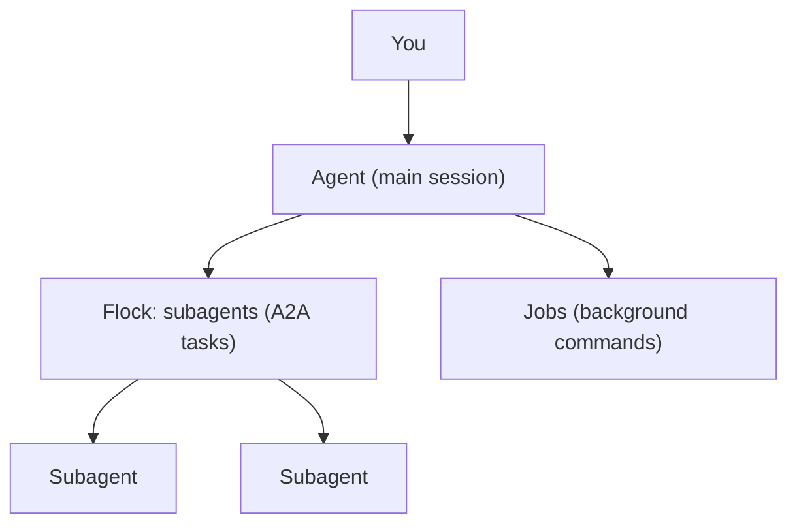

# What are the agent, the subagents and the jobs?

**What it is**

Loomcoding has three kinds of work unit. The agent is the main assistant of your session. Subagents are child agents that it starts for part of the work. Jobs are shell commands that run in the background.

**What it is for**

- Asking the agent for changes in your project.
- Handing an independent part of the work to a subagent.
- Running a long command in the background and checking it later.

**How**

1. Write your request in the composer and send it.
2. The agent works with tools and, when it is useful, starts subagents or jobs.
3. The header shows the flock, the set of subagents, and the state of each one.

## Example

```text
> /agents                    list the loaded agents
> /agent <name> <task>       run one of them with a task
```

## The three parts

| Part | What it is | Where you see it | Tools and commands |
|---|---|---|---|
| Agent | The main assistant of the project session. | The transcript and the composer. | Your own prompts. |
| Subagent | A child agent with its own work. It runs as an A2A task. | The flock in the header. | `subagent`, `subagent_list`, `subagent_control`; `/agents`, `/agent`, `/focus`, `/parent`. |
| Job | A shell command that runs in the background. | `job:` notices in the transcript. | `job_start`, `job_list`, `job_output`, `job_watch`, `job_kill`. |

## How it works



The agent decides when to delegate. The `delegation` setting only changes the rule in its prompt: `off` removes the subagent tools, `on_request` delegates only when you ask for it, and `proactive` delegates independent subtasks.

A subagent cannot start another subagent unless `max_depth` allows it. The default is `1`, which means no nesting. At most `max_active_subagents` subagents run at the same time.

A subagent that stops reporting progress is watched. After `stall_threshold_secs` without progress it shows as stalled. After `lost_threshold_secs` it is lost. By default a lost subagent is only reported (`lost_action = "notify"`). With `lost_action = "fail"`, its task is closed as failed and its work stops.

## Settings and defaults

| Name | Default | Requires restart |
|---|---|---|
| `[agents] max_active_subagents` | `8` (from 1 to 64) | Yes |
| `[agents] max_depth` | `1`, no nesting (from 1 to 3) | Yes |
| `[agents] delegation` | Not set: current behaviour. Values: `off`, `on_request`, `proactive` | Yes |
| `[agents] confirm_delegation` | `doubt`. Values: `always`, `never` | Yes |
| `[agents] stall_threshold_secs` | `120` (from 10 to 3600) | Yes |
| `[agents] lost_threshold_secs` | `300` (from 30 to 21600, and at least 30 seconds above the stall threshold) | Yes |
| `[agents] lost_action` | `notify`. Value: `fail` | Yes |

Loom reads the `[agents]` section when it creates the agent. Restart Loom after you edit it.

## Result

When it works, `/agents` lists the agents you have loaded, and the header shows the flock while subagents run. If a subagent is stalled or lost and you want to stop the turn, use `/cancel`.

## Next steps

- [Sessions](sessions.md)
- [Context and compaction](context-and-compaction.md)
- [A2A](a2a.md)
