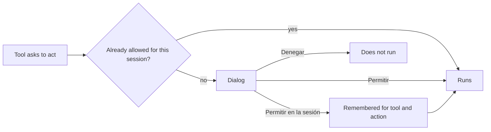

# How do I approve or deny what the agent does?

**What it is**

Some tools change things outside the conversation: they write or edit files, or run shell commands. Before they run, Loomcoding asks you for permission, unless you have started it in auto-approve mode.

**What it is for**

- Keeping control of every change to your project.
- Deciding case by case.
- Allowing a kind of action for the rest of the session, so it does not ask again.

**How**

1. Read the dialog. It shows the tool and its input: a command, or a diff for edits.
2. Choose one option. The dialog labels are in Spanish: `Permitir` (`a`), `Permitir en la sesión` (`s`) and `Denegar` (`d` or `Esc`).
3. Press Enter to confirm the highlighted option, or press the letter key directly.

## Example

```text
Dialog: bash
  command: cargo test
  [Permitir]  [Permitir en la sesión]  [Denegar]
```

`Permitir en la sesión` remembers the pair of tool and action, for example `bash` and `run`, and not one exact command. From then on, that pair does not ask again in the session. Use it only when you trust every command the tool may run.

## How it works



Loomcoding starts in one of three modes:

| Mode | How you start it | What happens with a permission request |
|---|---|---|
| Interactive | `loom` | The dialog opens and you decide. |
| Auto-approve | `loom --yolo` | Every request is approved without asking. Use it only in projects you trust. |
| Print | `loom --print "<prompt>"` | Every request is denied, unless you also use `--yolo`. |

A subagent that needs permission waits in the phase "awaiting permission", and the flock shows it.

Agents defined in the project folder need your approval before they run. The setting `trust_project_agents` approves them all without asking; it is off by default.

## Settings and defaults

| Name | Default | Requires restart |
|---|---|---|
| `--yolo` (launch flag) | Off | Not applicable: it applies to the launch in which you use it |
| `[agents] trust_project_agents` | `false` | Yes |

## Result

When you allow an action, the tool runs. When you deny it, the tool does not run. If you are not sure what a command does, deny it and ask the agent to explain it first.

## Next steps

- [Agents, subagents and jobs](agent-subagents-jobs.md)
- [Sessions](sessions.md)
