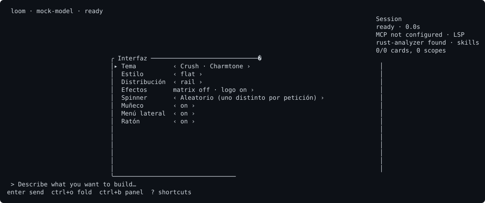

# Customize the interface with /ui, /theme and /layout

**What it is**

These commands change how the screen looks: the colour theme, the transcript style, the layout, and a few switches. A change applies at once and is saved in `ui.toml` in your profile folder.

**What it is for**

- Choosing a colour theme, or a transcript style.
- Choosing a screen layout, or showing the sidebar.
- Turning the status mascot or mouse capture on or off.

**How**

1. Type `/ui` to open the interface panel. `/temas` opens the same panel.
2. Or set one row directly, for example `/ui layout minimal`.
3. Or cycle quickly with `/theme` (colour theme) and `/layout` (layout).

## Example

```text
> /ui layout minimal
> /ui mouse off
> /theme
```



## Panel rows

| Row | Values | Default | Requires restart |
|---|---|---|---|
| `theme` | `cloth`, `martty`, `mindfork`, `pawan`, `crush`, `mastracode`, `loomcoding` | `cloth` | No |
| `style` | `classic`, `flat` | Set by the theme, with no override | No |
| `layout` | `workspace`, `rail`, `minimal`, `cards` | Set by the theme, with no override | No |
| `carril` (rail) | `tree`, `dots`, `bar`, `box`, `tint`, `none` | `tree` | No |
| `mascot` | `on`, `off` | `on` | No |
| `sidebar` | `on`, `off` | `off` | No |
| `mouse` | `on`, `off` | `on` | No |

The `effects` row opens a submenu, which `/ui effects` also opens. The `spinner` row can only be changed in the panel, with `/ui` or `/temas`.

## Commands

| Command | What it does | Requires restart |
|---|---|---|
| `/ui [row] [value]` | Opens the panel, or sets one row. | No |
| `/temas` | Opens the interface panel. | No |
| `/theme` | Cycles the colour theme. | No |
| `/layout` | Cycles the layout through `rail`, `minimal` and `cards`. | No |
| `/crush` | Switches to the Crush look. | No |
| `/classic` | Goes back to the Cloth look. | No |
| `/mouse` | Toggles mouse capture. With it off, you can select text with the mouse. | No |

The file is `<profile>/.loomcoding/ui.toml`. `<profile>` is your home folder, or the folder in `LOOMCODING_HOME` when that variable is set.

## Result

The panel shows each row with its current value, and a change appears at once.

## If it does not work

| Symptom | Fix |
|---|---|
| "Unknown row" or "Unknown value" appears. | The message lists the valid names. Nothing changes, and your text stays in the input. |
| A "not saved" message appears. | The change applies to this session, but `ui.toml` could not be written. Check the folder permissions. |
| The settings are back after a restart. | The file was not written, or `LOOMCODING_HOME` points to another folder. |

## Next steps

- [What happens on the first run](../start/first-run.md)
- [Send your first prompt](../start/first-prompt.md)
