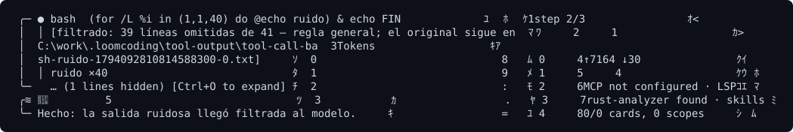

# Turn on output compression for command output

**What it is**

Output compression removes noise from the output of `bash` and `job_output` before the model reads it, for example colour codes, repeated lines and progress bars. It is off by default.

**What it is for**

- Reducing the tokens that long outputs of `cargo test`, `cargo build` or `npm install` cost.
- Keeping errors, warnings and summaries, which are never removed.

**How**

1. In the project `loomcoding.toml`, add `[output_filter]` with `enabled = true`.
2. Restart Loomcoding.
3. Run a command with noisy output. When the filter removes something, the output starts with a `[filtrado: …]` header.

## Example

```toml
[output_filter]
enabled = true
```

The header looks like this. Its text is in Spanish, and the placeholder is the path of the saved original output:

```text
[filtrado: 2 líneas omitidas de 5 — regla general; el original sigue en <ruta del volcado>]
```



## Rules

| Rule | What it removes | What it keeps |
|---|---|---|
| General (any text) | Colour and control codes, progress bars, repeated lines (shown as `×N`), blank lines. | Everything else. |
| `cargo test`, `build`, `check`, `clippy` | Lines of compilation in progress, downloads, earlier `Finished` lines, `test … ok` lines. | Errors, warnings, `FAILED`, `panicked` and the summary. |
| `git status` (long format) | Repeated `(use "git …")` hints. | The rest. |
| `npm install`, `pnpm install` | pnpm progress bars and repeated deprecation notices. | The last progress line. Repeated notices are counted. |

The command rules apply only to simple commands, without pipes, `&&`, `;`, substitutions or redirections. `2>&1` is allowed. `git diff` and `git log` get only the general rules.

## The original output

- The header gives the path of a file that holds the full original output. Such files are kept for 7 days.
- The model can ask for unfiltered output with `raw: true` in `bash` or `job_output`.
- If the original cannot be saved, the output passes through unchanged.

## Settings and defaults

| Name | Default | Requires restart |
|---|---|---|
| `[output_filter] enabled` | `false` | Yes |
| `LOOMCODING_NO_FILTER=1` (environment variable) | not set | Yes. It turns the filter off even when the file enables it. |

## Automatic switch-off

A rule with at least 10 uses and more than 20 % re-requests is turned off for the rest of the process. You get one notice when that happens. A rule that is turned off stays off until you restart Loomcoding.

## Result

When it works, the noisy outputs start with the `[filtrado: …]` header. When there is no header, the command did not match a rule, or its output did not look as expected. The output then passes unchanged.

## If it does not work

| Symptom | Fix |
|---|---|
| No header appears. | Check that the file is saved and that you restarted Loomcoding. Check that `LOOMCODING_NO_FILTER` is not set. |
| The filtered output hides something you need. | Ask for the output with `raw: true`. The rule may be too strict; report the case. |
| A rule stopped working in the middle of a session. | It was switched off automatically. Restart Loomcoding to turn it on again. |

## Next steps

- [Measure with RUST_LOG](measure-with-rust-log.md)
- [Watch a background job](watch-a-job.md)
- [Context and compaction](../concepts/context-and-compaction.md)
- [Technical note: output filter](../../../output-filter.md)
