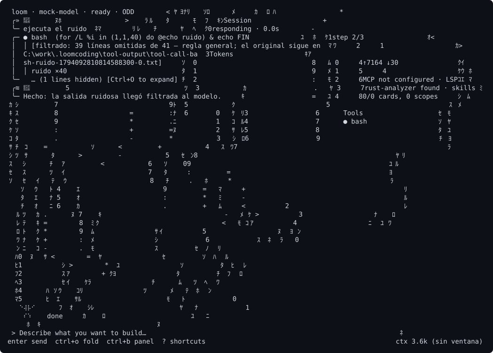

# Send your first prompt

**What it is**

A prompt is a message you type in the composer. This page sends one in a project that already has a working provider.

**What it is for**

- Checking that the provider answers.
- Learning the keys and commands you need in the first session.

**How**

1. Start `loom` in your project folder.
2. Type a short question about the project, for example `What does this folder contain?`.
3. Press Enter.

## Example

```text
> What does this folder contain? List the main files.
```



## Keys and commands

| Key or command | Default | Requires restart | What it does |
|---|---|---|---|
| Enter | Not applicable | No | Sends the prompt. |
| Ctrl+J | Not applicable | No | Inserts a new line in the composer. |
| `/help` | Not applicable | No | Opens the keyboard shortcuts. `/help model` explains one command. |
| `/cancel` | Not applicable | No | Cancels the active turn and pauses the queue of pending prompts. |
| `/new` | Not applicable | No | Starts a new session. Only when the agent is idle. |
| `/sessions` | Not applicable | No | Switches to another session. Only when the agent is idle. |

## Result

- When the provider answers, the reply appears in the conversation.
- When the agent asks to run a tool, a permission dialog appears. Answer it with the keys the dialog shows.
- If the reply says `No API key configured`, go back to [Connect a cloud provider](cloud-provider.md).
- If the provider shows `down`, go to [Run a local model server](local-provider.md).

## Next steps

- [Start here](index.md)
- [Install Loomcoding](install.md)
