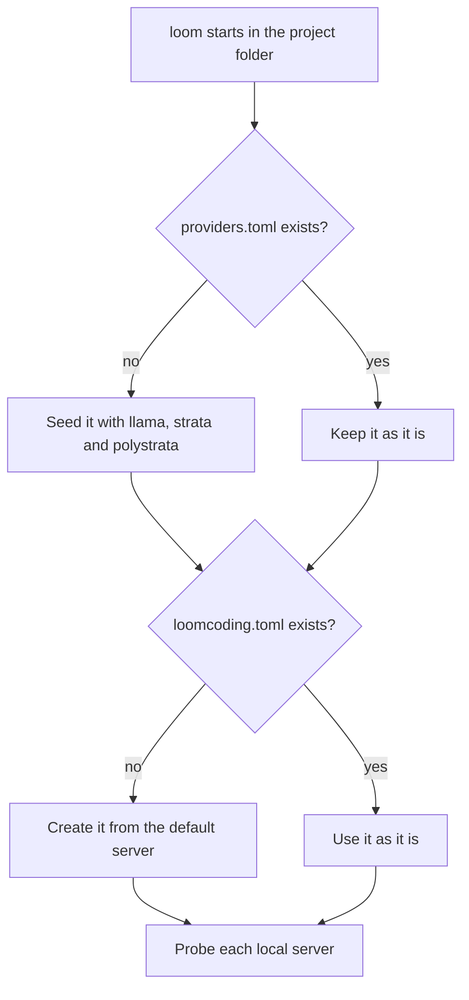

# What happens on the first run

**What it is**

The first start of `loom` creates a few files that decide which provider a new project uses. This page lists them, and where they go.

**What it is for**

- Knowing which files appear, and where.
- Knowing why a new project may point at a local server that you have not started.

**How**

1. Open a terminal in your project folder.
2. Run `loom`.
3. Loomcoding creates the missing files below. It never overwrites a file that already exists.

## Example

```text
PS> cd <project-folder>
PS> loom
```

## What loom creates

| File | Location | Created when | Content at creation |
|---|---|---|---|
| `providers.toml` | `<profile>/.loomcoding/` | It is missing | Three local servers and `default = "llama"` |
| `loomcoding.toml` | The project folder | It is missing | The model and `[provider]` of the default server |
| `.env` | The project folder | Never: you create it | Your keys, optional |



Loomcoding probes each local server with one `GET <base_url>/models` request, with a 1.5-second limit. It never sends a prompt during the probe.

If the system has no home folder, there is no profile and no `providers.toml`. Then a new `loomcoding.toml` uses OpenRouter, the model `nvidia/nemotron-3.5-super-vl:free`, and `max_steps = 8`.

## Settings and defaults

| Name | Default | Requires restart |
|---|---|---|
| `default` in `providers.toml` | `llama` | Yes |
| `model` in `loomcoding.toml` | The `model` of the default server | Yes after a manual edit; no after `/model` |
| `max_steps` in `loomcoding.toml` | `8` in the created file; `30` when the key is missing | Yes after a manual edit |
| `[provider] kind` in `loomcoding.toml` | The `kind` of the default server, `openai_compat` | Yes after a manual edit; no after `/settings` |
| `[provider] base_url` in `loomcoding.toml` | The `base_url` of the default server, `http://127.0.0.1:8081/v1` | Yes after a manual edit; no after `/settings` |

## Result

- A new project opens with the default local server selected, even if that server is not running.
- A server that is not running shows `down` in `/provider`. Prompts fail until you start it or switch provider.
- To change the provider, see [Connect a cloud provider](cloud-provider.md) or [Run a local model server](local-provider.md).
- To start from a clean profile, set `LOOMCODING_HOME` to a new empty folder.

## Next steps

- [Connect a cloud provider](cloud-provider.md)
- [Run a local model server](local-provider.md)
