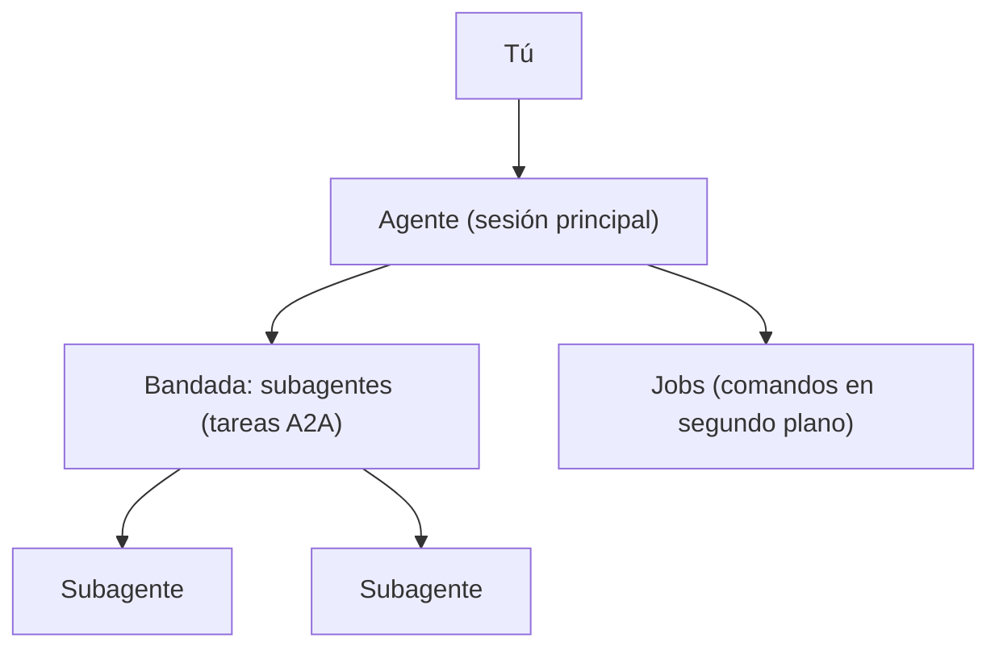

# ¿Qué son el agente, los subagentes y los jobs?

**Qué es**

Loomcoding tiene tres tipos de unidad de trabajo. El agente es el asistente principal de tu sesión. Los subagentes son agentes hijos que él lanza para una parte del trabajo. Los jobs son comandos de terminal que se ejecutan en segundo plano.

**Para qué**

- Pedir al agente cambios en tu proyecto.
- Encargar una parte independiente del trabajo a un subagente.
- Ejecutar un comando largo en segundo plano y consultarlo después.

**Cómo**

1. Escribe tu petición en el compositor y envíala.
2. El agente trabaja con herramientas y, cuando conviene, lanza subagentes o jobs.
3. La cabecera muestra la bandada (el «flock»), es decir, el conjunto de subagentes, y el estado de cada uno.

## Ejemplo

```text
> /agents                    lista los agentes cargados
> /agent <nombre> <tarea>    ejecuta uno de ellos con una tarea
```

## Las tres partes

| Parte | Qué es | Dónde se ve | Herramientas y comandos |
|---|---|---|---|
| Agente | El asistente principal de la sesión del proyecto. | La transcripción y el compositor. | Tus propias peticiones. |
| Subagente | Un agente hijo con su propio trabajo. Se ejecuta como tarea A2A. | La bandada en la cabecera. | `subagent`, `subagent_list`, `subagent_control`; `/agents`, `/agent`, `/focus`, `/parent`. |
| Job | Un comando de terminal que se ejecuta en segundo plano. | Avisos `job:` en la transcripción. | `job_start`, `job_list`, `job_output`, `job_watch`, `job_kill`. |

## Cómo funciona



El agente decide cuándo delegar. El ajuste `delegation` solo cambia la regla de su prompt: `off` retira las herramientas de subagentes, `on_request` delega solo si lo pides y `proactive` delega las subtareas independientes.

Un subagente no puede lanzar otro salvo que `max_depth` lo permita. Por defecto vale `1`, es decir, sin anidamiento. Como máximo se ejecutan a la vez `max_active_subagents` subagentes.

Un subagente que deja de informar de su progreso se vigila. Tras `stall_threshold_secs` sin progreso aparece como atascado. Tras `lost_threshold_secs` se da por perdido. Por defecto, un subagente perdido solo se notifica (`lost_action = "notify"`). Con `lost_action = "fail"`, su tarea se cierra como fallida y su trabajo se detiene.

## Ajustes y valores por defecto

| Nombre | Valor por defecto | Requiere reiniciar |
|---|---|---|
| `[agents] max_active_subagents` | `8` (de 1 a 64) | Sí |
| `[agents] max_depth` | `1`, sin anidamiento (de 1 a 3) | Sí |
| `[agents] delegation` | Sin valor: comportamiento actual. Valores: `off`, `on_request`, `proactive` | Sí |
| `[agents] confirm_delegation` | `doubt`. Valores: `always`, `never` | Sí |
| `[agents] stall_threshold_secs` | `120` (de 10 a 3600) | Sí |
| `[agents] lost_threshold_secs` | `300` (de 30 a 21600, y al menos 30 segundos por encima del umbral de atasco) | Sí |
| `[agents] lost_action` | `notify`. Valor: `fail` | Sí |

Loom lee la sección `[agents]` al crear el agente. Reinicia Loom después de editarla.

## Resultado

Si todo funciona, `/agents` lista los agentes cargados y la cabecera muestra la bandada mientras corren los subagentes. Si un subagente aparece como atascado o perdido y quieres detener el turno, usa `/cancel`.

## Siguientes pasos

- [Sesiones](sessions.md)
- [Contexto y compactación](context-and-compaction.md)
- [A2A](a2a.md)
