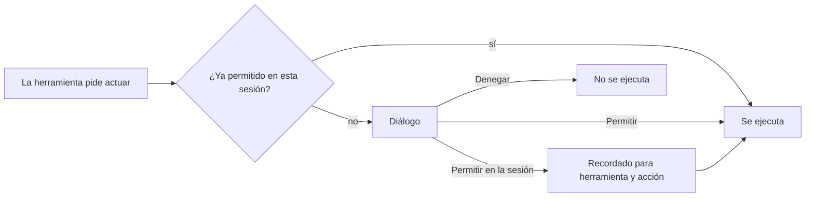

# ¿Cómo apruebo o deniego lo que hace el agente?

**Qué es**

Algunas herramientas cambian cosas fuera de la conversación: escriben o editan ficheros, o ejecutan comandos de terminal. Antes de ejecutarlas, Loomcoding te pide permiso, salvo que lo hayas arrancado en modo de aprobación automática.

**Para qué**

- Mantener el control de cada cambio en tu proyecto.
- Decidir caso por caso.
- Permitir un tipo de acción durante la sesión para que no vuelva a preguntar.

**Cómo**

1. Lee el diálogo. Muestra la herramienta y su entrada: un comando o, en las ediciones, un diff.
2. Elige una opción. Las etiquetas del diálogo están en español: `Permitir` (`a`), `Permitir en la sesión` (`s`) y `Denegar` (`d` o `Esc`).
3. Pulsa Intro para confirmar la opción marcada, o pulsa directamente la tecla de la letra.

## Ejemplo

```text
Diálogo: bash
  comando: cargo test
  [Permitir]  [Permitir en la sesión]  [Denegar]
```

`Permitir en la sesión` recuerda la pareja de herramienta y acción, por ejemplo `bash` y `run`, y no un comando concreto. A partir de ahí, esa pareja no vuelve a preguntar en la sesión. Úsalo solo si confías en cualquier comando que pueda ejecutar la herramienta.

## Cómo funciona



Loomcoding arranca en uno de tres modos:

| Modo | Cómo se arranca | Qué pasa con una petición de permiso |
|---|---|---|
| Interactivo | `loom` | Se abre el diálogo y decides tú. |
| Aprobación automática | `loom --yolo` | Cada petición se aprueba sin preguntar. Úsalo solo en proyectos de confianza. |
| Impresión | `loom --print "<prompt>"` | Cada petición se deniega, salvo que uses también `--yolo`. |

Un subagente que necesita permiso espera en la fase «esperando permiso», y la bandada lo muestra.

Los agentes definidos en la carpeta del proyecto necesitan tu aprobación antes de ejecutarse. El ajuste `trust_project_agents` los aprueba todos sin preguntar; está desactivado por defecto.

## Ajustes y valores por defecto

| Nombre | Valor por defecto | Requiere reiniciar |
|---|---|---|
| `--yolo` (opción de arranque) | Desactivada | No aplica: afecta al arranque en el que la usas |
| `[agents] trust_project_agents` | `false` | Sí |

## Resultado

Si permites una acción, la herramienta se ejecuta. Si la deniegas, no se ejecuta. Si no sabes qué hace un comando, deniégalo y pide al agente que te lo explique antes.

## Siguientes pasos

- [Agentes, subagentes y jobs](agent-subagents-jobs.md)
- [Sesiones](sessions.md)
