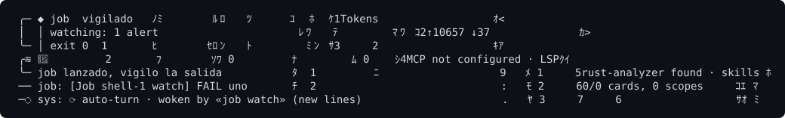

# Vigilar un job en segundo plano mientras se ejecuta

**Qué es**

Un job es un comando de shell que se ejecuta en segundo plano. Una vigilancia hace que Loomcoding te envíe las líneas de salida que casan con un patrón mientras el job sigue en marcha, en lugar de esperar a que termine.

**Para qué**

- Ver un error de compilación o una prueba fallida en cuanto aparece.
- Esperar a que un servidor anuncie que está listo.
- Evitar comprobar la salida una y otra vez.

**Cómo**

1. Pide al agente que arranque el comando como job, con un patrón que vigilar.
2. Lee los avisos `job:` del transcript a medida que llegan.
3. Pide al agente que cambie o quite la vigilancia con `job_watch`, o que detenga el job con `job_kill`.

## Ejemplo

Tu prompt:

```text
> Arranca "cargo watch -x test" como job y avísame cuando falle una prueba.
```

El agente llama a `job_start` con un objeto `watch`, así:

```json
{ "command": "cargo watch -x test", "label": "tests",
  "watch": { "pattern": "FAILED|error\\[", "max_events": 20 } }
```

Cada aviso tiene esta forma en el transcript:

```text
job: [Job 2 watch] <línea de salida que casa>
```



## Herramientas

| Herramienta | Parámetros | Qué hace |
|---|---|---|
| `job_start` | `command`, `label` opcional, `watch` opcional (`pattern`, `max_events`) | Arranca un job. Un patrón incorrecto falla antes de arrancar el comando. |
| `job_watch` | `job_id`, `pattern` opcional, `max_events` opcional | Añade, cambia o quita la vigilancia de un job en marcha. Un patrón vacío la quita. Solo se vigilan las líneas impresas después de la llamada. |
| `job_output` | id del job | Lee la salida de un job. |
| `job_list` | ninguno | Lista los jobs de esta sesión. |
| `job_kill` | id del job | Detiene un job. |

## Límites

| Límite | Valor |
|---|---|
| Longitud del patrón | 256 bytes como máximo |
| `max_events` | De 1 a 100. Por defecto, 20. |
| Longitud de cada línea avisada | 512 bytes como máximo |
| Avisos por job | Como máximo uno cada 5 segundos, con hasta 10 líneas cada uno |
| Alcance | Solo los jobs de la sesión actual |

## Ajustes y valores por defecto

| Nombre | Valor por defecto | Requiere reiniciar |
|---|---|---|
| `watch.max_events` (por llamada) | `20` | No |
| Intervalo entre avisos | `5` segundos, fijo | No configurable |

Cuando el agente está ocioso, un aviso de vigilancia puede despertarlo, dentro del mismo presupuesto de turnos automáticos que usan los subagentes. Cuando se agota el presupuesto, el aviso espera a tu siguiente mensaje.

## Resultado

Ves líneas `job:` mientras el comando se ejecuta. Cuando el job termina, llega el aviso normal de fin y la vigilancia se cierra.

## Si no funciona

| Síntoma | Solución |
|---|---|
| `job_start` falla con un error de vigilancia. | El patrón no es válido o es demasiado largo. Simplifícalo. El comando no se arrancó. |
| `job_watch` dice que el job ha terminado. | Las vigilancias solo se aplican a jobs en marcha. Arranca un job nuevo. |
| No llega ningún aviso. | Ninguna línea impresa después de la llamada casa con el patrón, o la salida todavía no ha llegado a la siguiente ventana de 5 segundos. |
| Los avisos se detienen. | Se alcanzó el límite `max_events`. Un último aviso lo indica. Usa `job_watch` con un nuevo `max_events` para subirlo. |

## Siguientes pasos

- [Agentes, subagentes y jobs](../concepts/agent-subagents-jobs.md)
- [Permisos](../concepts/permissions.md)
- [Activar la compresión de la salida](turn-on-output-compression.md)
