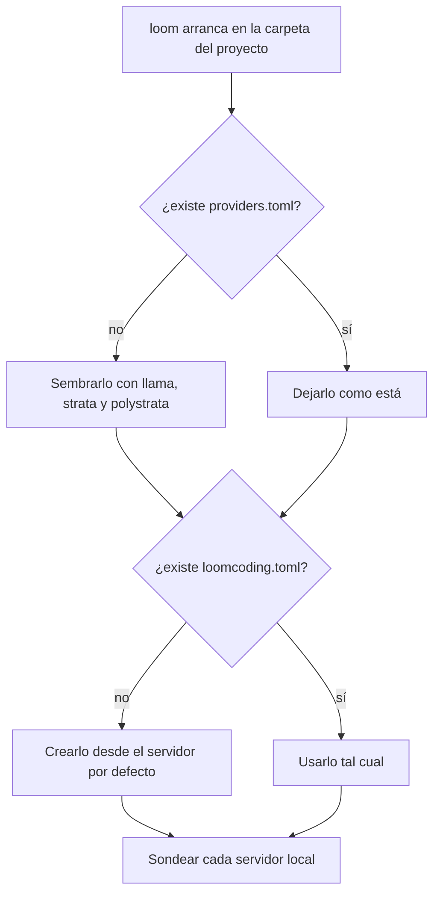

# Qué pasa en el primer arranque

**Qué es**

El primer arranque de `loom` crea unos cuantos ficheros que deciden qué proveedor usa un proyecto nuevo. Esta página los enumera y dice dónde van.

**Para qué**

- Saber qué ficheros aparecen y dónde.
- Entender por qué un proyecto nuevo puede apuntar a un servidor local que no has arrancado.

**Cómo**

1. Abre una terminal en la carpeta de tu proyecto.
2. Ejecuta `loom`.
3. Loomcoding crea los ficheros que falten de la lista. Nunca sobrescribe un fichero que ya existe.

## Ejemplo

```text
PS> cd <carpeta-del-proyecto>
PS> loom
```

## Qué crea loom

| Fichero | Ubicación | Cuándo se crea | Contenido al crearse |
|---|---|---|---|
| `providers.toml` | `<perfil>/.loomcoding/` | Si falta | Tres servidores locales y `default = "llama"` |
| `loomcoding.toml` | La carpeta del proyecto | Si falta | El modelo y `[provider]` del servidor por defecto |
| `.env` | La carpeta del proyecto | Nunca: lo creas tú | Tus claves, opcional |



Loomcoding sondea cada servidor local con una petición `GET <base_url>/models`, con un plazo de 1,5 segundos. Durante el sondeo nunca envía un prompt.

Si el sistema no tiene carpeta personal, no hay perfil ni `providers.toml`. Entonces un `loomcoding.toml` nuevo usa OpenRouter, el modelo `nvidia/nemotron-3.5-super-vl:free` y `max_steps = 8`.

## Ajustes y valores por defecto

| Nombre | Valor por defecto | Requiere reiniciar |
|---|---|---|
| `default` en `providers.toml` | `llama` | Sí |
| `model` en `loomcoding.toml` | El `model` del servidor por defecto | Sí tras editarlo a mano; no tras `/model` |
| `max_steps` en `loomcoding.toml` | `8` en el fichero creado; `30` si falta la clave | Sí tras editarlo a mano |
| `[provider] kind` en `loomcoding.toml` | El `kind` del servidor por defecto, `openai_compat` | Sí tras editarlo a mano; no tras `/settings` |
| `[provider] base_url` en `loomcoding.toml` | El `base_url` del servidor por defecto, `http://127.0.0.1:8081/v1` | Sí tras editarlo a mano; no tras `/settings` |

## Resultado

- Un proyecto nuevo se abre con el servidor local por defecto seleccionado, aunque ese servidor no esté en marcha.
- Un servidor apagado aparece como `down` en `/provider`. Los prompts fallan hasta que lo arranques o cambies de proveedor.
- Para cambiar de proveedor, consulta [Conectar un proveedor en la nube](cloud-provider.md) o [Usar un servidor de modelos local](local-provider.md).
- Para empezar con un perfil limpio, apunta `LOOMCODING_HOME` a una carpeta nueva y vacía.

## Siguientes pasos

- [Conectar un proveedor en la nube](cloud-provider.md)
- [Usar un servidor de modelos local](local-provider.md)
